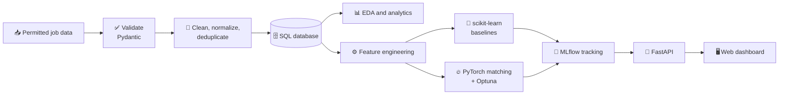

# 📊 JobStack

**Turn Pakistan tech job postings into skills intelligence, salary and fit prediction, and evidence-based career decisions.**


> 🧭 **North star:** Don't build a website that merely tells people where jobs are. Build a system that helps them understand the market and decide what to do next.

---

## 🚧 Project status

JobStack is in **early development**. The repository currently contains documentation only. Everything marked 🗓️ *Planned* describes the intended design and will be updated as code is added.

---

## ✨ What is this?

Job ads hold useful signals about skills, experience, location, work mode, and sometimes salary. They are hard to use directly:

🔀 Job titles and skill names vary · 💸 Salary is often missing · 👯 Duplicate listings distort counts · 🤷 A list of vacancies doesn't say what to do next

JobStack adds a structured, evidence-driven layer between raw postings and practical decisions. It starts with Pakistan's technology job market. It is a **decision-support project**, not a job board or an automated hiring authority.

### 👥 Who it's for

| Audience | What they get |
|---|---|
| 🎓 Students and job seekers | In-demand skills and learning priorities |
| 🧑‍💼 Recruiters and talent teams | Role requirements and market patterns |
| 🛠️ Engineering leaders | Recurring skill requirements across roles |
| 🏫 Universities and training providers | How job-market demand relates to learning outcomes |

---

## 🎯 Key features

> 🗓️ *Planned. Not yet implemented.*

| Area | Feature |
|---|---|
| 📈 **Market intelligence** | Skill demand by role, city, experience level, and time period |
| 🕸️ **Skill networks** | Skill co-occurrence and role similarity exploration |
| 💰 **Salary insight** | Salary distributions for records with usable salary data |
| 🎯 **Job-fit score** | Explainable score with matched and missing skills |
| 🧗 **Skill gaps** | Prioritized suggestions for what to learn next |
| 🔬 **Experiment tracking** | Reproducible pipelines, tuning, and model comparison |

---

## 🔁 How it works



---

## 🧰 Tech stack

| Layer | Tools | Purpose |
|---|---|---|
| 📥 Ingestion | Python, `requests` or a permitted API client | Retrieve source data |
| ✅ Validation | Pydantic | Schema and data-quality checks |
| 🧹 Transformation | Pandas | Cleaning and feature engineering |
| 🗄️ Database | PostgreSQL (SQLite for prototyping) | Normalized storage |
| 📊 Analysis | Pandas, Matplotlib / Plotly | Exploration and visualization |
| 🌲 Classical ML | scikit-learn | Prediction baselines |
| 🔥 Deep learning | PyTorch | Job-candidate compatibility |
| 🎛️ Tuning | Optuna | Hyperparameter optimization |
| 📒 Tracking | MLflow | Parameters, metrics, artifacts, model versions |
| 🚀 Backend | FastAPI | REST API |
| 🖥️ Frontend | React (or team-approved framework) | Interactive dashboard |

### 🗃️ Data model

| Table | Description |
|---|---|
| `postings` | Title, company, location, description, experience, work mode, date, source |
| `companies` | Company metadata where available |
| `locations` | City, province, country |
| `skills` | Canonical skill names and categories |
| `posting_skills` | Many-to-many link between postings and skills, with evidence metadata |
| `salary_observations` | Salary range, currency, pay period, normalized salary |

### 🗺️ Roadmap

| Stage | Focus | Status |
|---|---|---|
| 1️⃣ Data foundation | ETL, validation, SQL, EDA | ⬜ Not started |
| 2️⃣ Classical ML | Salary estimation and job-fit baseline | ⬜ Not started |
| 3️⃣ Deep learning and MLOps | PyTorch matching, Optuna, MLflow | ⬜ Not started |
| 🖥️ Product layer | Web app and REST API | ⬜ Not started |
| 🧪 Validation | Professional feedback | ⬜ Not started |

---

## 🚀 Quick start

> ⚠️ The repo has no application code yet, so there is nothing to run. These steps set up your environment and will work once dependency files are added.

**1. 📦 Clone the repository**

```bash
git clone https://github.com/munibashami07-oss/JobStack-through-python.git
cd JobStack-through-python
```

**2. 🐍 Create a virtual environment**

```bash
python -m venv .venv
```

```bash
# macOS / Linux
source .venv/bin/activate
```

```powershell
# Windows (PowerShell)
.\.venv\Scripts\Activate.ps1
```

**3. 📥 Install dependencies** *(once `requirements.txt` is added)*

```bash
pip install -r requirements.txt
```

**4. 🔐 Configure environment** *(once `.env.example` is added)*

```bash
cp .env.example .env
```

**5. ▶️ Run the API** *(planned)*

```bash
uvicorn app.main:app --reload
```

---

## 🧪 Usage examples and configuration

> 🗓️ *Planned. Endpoints and module names are illustrative.*

### ⚙️ Configuration

| Variable | Description | Required |
|---|---|---|
| `DATABASE_URL` | Database connection string | ✅ Yes |
| `JOB_DATA_API_KEY` | Key for an approved job-data API | Only if the source requires it |

🔒 Never commit `.env` files or credentials.

### 🔎 Query the API

```bash
# Top skills for a role
curl "http://127.0.0.1:8000/skills/top?role=backend&city=Lahore"
```

```bash
# Job-fit score for a candidate profile
curl -X POST "http://127.0.0.1:8000/fit" \
  -H "Content-Type: application/json" \
  -d '{"skills": ["python", "sql", "fastapi"], "target_role": "data engineer"}'
```

### 🏭 Run the data pipeline

```bash
python -m pipeline.ingest --source <permitted-source>
python -m pipeline.clean
python -m pipeline.load
```

---

## 🧷 Data principles

- ✅ **Use permitted sources:** official APIs, licensed datasets, or data whose terms allow reuse
- 🧾 **Document provenance:** source, collection date, usage conditions
- 🔍 **Validate before analysis:** fields, types, ranges, duplicates
- 💸 **Missing salary is not zero**
- 👯 **Avoid duplicate inflation** and keep posting dates
- 🔒 **Protect personal information:** never commit personal data, secrets, or credentials

---

## 🧪 Testing and limitations

_To be added._

---

## 🤝 Contributing

Contributions are welcome in data engineering, analytics, ML, backend, frontend, docs, and testing. At this early stage, the most useful help is schema design, data-source review, and project structure.

1. 🔎 **Check existing work.** Review [issues](https://github.com/munibashami07-oss/JobStack-through-python/issues) and [pull requests](https://github.com/munibashami07-oss/JobStack-through-python/pulls). For big changes, open an issue first.
2. 🍴 **Fork** the repo and clone your fork:
   ```bash
   git clone https://github.com/<your-username>/JobStack-through-python.git
   cd JobStack-through-python
   ```
3. 🌿 **Create a focused branch** from `main`:
   ```bash
   git checkout -b type/short-description
   ```
   Prefixes: `feature/` `fix/` `docs/` `test/` `refactor/` `data/`
4. 🛠️ **Make a focused change.** Keep PRs small; don't mix refactors and features.
5. ✅ **Add or update tests.** For data or model changes, document the expected behavior and how you evaluated it.
6. 🧹 **Run checks locally:** tests, formatter, linter (once configured).
7. 💬 **Commit with a clear message:**
   ```bash
   git commit -m "feat: add canonical skill normalization"
   ```
   More examples: `fix: handle missing salary ranges` · `test: cover duplicate posting detection` · `docs: clarify local database setup`
8. 📤 **Push and open a pull request** against `main`. Describe the problem, solution, testing, and trade-offs. Add screenshots for UI changes.
9. 🔁 **Respond to review feedback.**

### ☑️ Pull request checklist

- [ ] Addresses one clear problem or improvement
- [ ] Preserves existing behavior unless intentionally changed
- [ ] Includes tests or a manual verification plan
- [ ] Updates docs and configuration examples
- [ ] Contains no credentials, private data, or unlicensed datasets
- [ ] Justifies and documents new dependencies
- [ ] Reports metrics and limitations for model changes
- [ ] UI changes are responsive and accessible

### 📐 Data and model contributions

- Include source and licensing details
- Explain cleaning, deduplication, and missing-value handling
- Don't commit large raw datasets unless the license allows it
- Keep train/validation/test separate; never tune on the test set
- Compare complex models against a baseline
- Don't present correlations as causation or model scores as hiring decisions

### 🐞 Bugs and feature requests

**Bug report:** what happened, what you expected, steps to reproduce, logs (secrets removed), environment and versions.

**Feature request:** the user problem, who benefits, a reasonable first version, how to measure success, and any data, privacy, licensing, or maintenance concerns.

---

## 📚 References

- [Lightcast: Job Postings](https://lightcast.io/our-data/postings)
- [Lightcast: Job Posting Analytics Methodology](https://kb.lightcast.io/en/articles/6957446-job-posting-analytics-jpa-methodology)
- [Adzuna API Overview](https://developer.adzuna.com/overview)
- [Adzuna Jobsworth](https://developer.adzuna.com/docs/jobsworth)
- [P@SHA Skills Survey 2025 summary](https://www.linkedin.com/posts/pashapk_pashareport-skillsreport2025-pashaskillssurvey-activity-7370781643378331648-YKM_)
- [Analysing IT Job Market Dynamics in Pakistan (2026 preprint)](https://www.preprints.org/manuscript/202609.0274)
- [Indeed: Software Engineer salary in Pakistan](https://pk.indeed.com/career/software-engineer/salaries)

These sources give context and are not necessarily JobStack's data sources. Any source used to populate the project must be reviewed independently for access, licensing, and reuse conditions.

---

## ⭐ Support

If JobStack is useful to you, give the repo a **star** ⭐ and share it with someone exploring the tech job market.

Made with ❤️ by **[Muniba](https://github.com/munibashami07-oss)**
