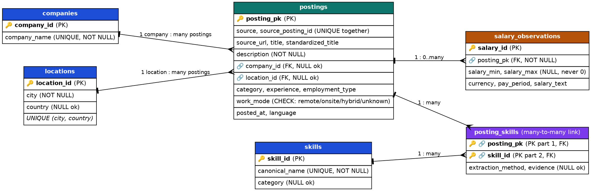
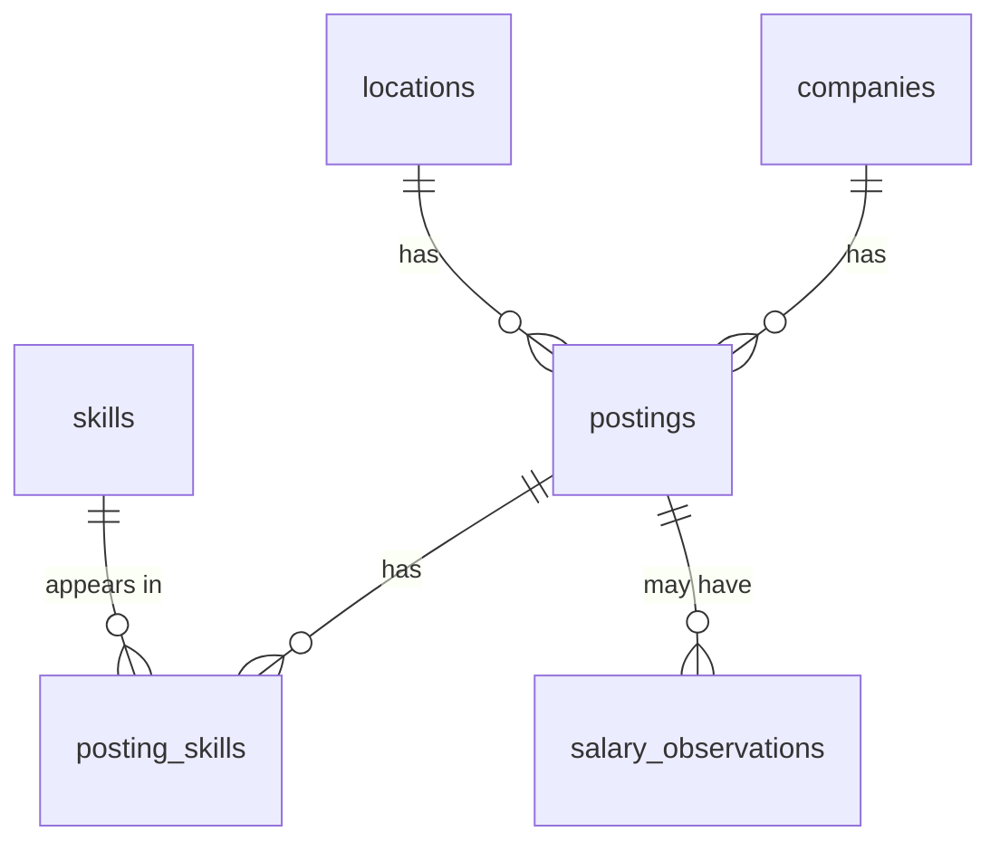

# JobStack database guide (Person 3: SQL Database Engineering)

How to rebuild the database from scratch, what is in it, and why it is designed this way.

## 1. Rebuild from scratch (no manual row-by-row work)

From the repository root:

```bash
pip install -r requirements.txt

# Build schema + indexes + views, load data/transformed/jobs_final.json, run QA checks
python -m src.database.load_database

# Print every analytical query result (also useful for the demo)
python -m src.database.run_queries

# Run the database tests
python -m pytest tests/test_database.py
```

Output file: `data/jobstack_final.db` (SQLite, git-ignored). The script deletes and rebuilds this file every run, so the result is reproducible. Custom paths: `--src <json>` and `--db <file>`.

Prerequisite: Person 2's `data/transformed/jobs_final.json` must exist. Person 1's `src/ingestion/load_db.py` is a separate flat prototype table and is not part of this database.

## 2. Files

| Path | Purpose |
|---|---|
| `sql/01_schema.sql` | 6 tables with keys, UNIQUE, NOT NULL, CHECK constraints |
| `sql/02_indexes.sql` | Indexes on foreign keys and common filters |
| `sql/03_views.sql` | `v_postings_flat`, `v_posting_skills_flat`, `v_skill_counts` for EDA (Person 4) |
| `sql/04_queries.sql` | Core metrics: city, role, skills, salary coverage, experience, work mode, skill pairs |
| `sql/05_qa_checks.sql` | Manual integrity checks (every "problem" query must return 0) |
| `src/database/load_database.py` | Builds the database and loads the data, then runs QA |
| `src/database/run_queries.py` | Runs all queries in `04_queries.sql` |
| `tests/test_database.py` | Automated tests on a small fake dataset |
| `reports/database/jobstack_erd.png` | ERD |

## 3. ERD





## 4. Column to table mapping

| `jobs_final.json` field | Destination |
|---|---|
| `source`, `posting_id` | `postings.source`, `postings.source_posting_id` |
| `title`, `standardized_title`, `source_url`, `category`, `experience`, `posted_at`, `language` | `postings` |
| `cleaned_description` | `postings.description` |
| `standardized_employment_type`, `standardized_work_mode` | `postings.employment_type`, `postings.work_mode` |
| `company_name` | `companies` then `postings.company_id` |
| `standardized_city`, `country` | `locations` then `postings.location_id` |
| `extracted_skills` (list) | `skills` + `posting_skills` |
| `salary_min`, `salary_max`, `currency`, `salary_text` | `salary_observations` (only when any value exists) |
| Not loaded | `tags`, `candidate_location`, raw `city`, raw `description`, `cleaned_*` helper columns |

## 5. Design decisions

1. **Surrogate key `posting_pk`.** The data contract says identity is (`source`, `posting_id`); `posting_id` alone is not unique across sources. We keep a simple integer key for joins and enforce the real identity with `UNIQUE (source, source_posting_id)`.
2. **Many-to-many via `posting_skills`.** One posting has many skills and one skill appears in many postings. The link table has a composite primary key, so a skill cannot repeat within one posting.
3. **NULL is kept as NULL.** Unknown company or city leaves the foreign key NULL. No placeholder values like "Unknown" are invented.
4. **NULL-safe lookups.** In SQL, `NULL = NULL` is not true, so a `UNIQUE (city, country)` rule cannot stop duplicate rows where `country` is NULL. The loader looks rows up with `IS ?`, which treats NULL as equal to NULL.
5. **Salary is never 0.** Missing salary is NULL. A CHECK rejects negative values and `max < min`. The QA reports salary coverage.
6. **Description is the cleaned text.** Person 2's cleaned text (HTML stripped) is stored. Raw HTML stays in the `data/` files, which are never modified.
7. **Foreign keys are switched on.** SQLite ignores foreign keys unless `PRAGMA foreign_keys = ON` is set on each connection; the loader and schema do so.

## 6. Expected result for the current 300-row sample

| Table | Rows |
|---|---|
| companies | 259 |
| locations | 69 |
| skills | 20 |
| postings | 300 |
| posting_skills | 234 |
| salary_observations | 3 |

All QA checks pass: row counts match the input, 0 foreign key violations, no salary stored as 0. If Person 2 re-runs the transformation on the full dataset, the counts change; the QA compares against the input and does not hard-code these numbers.

## 7. Limitations visible in the data

- **Salary is practically absent.** 0 of 300 postings have a numeric salary; 3 have free-text salary only. No salary analysis is possible from this sample; report the coverage instead.
- **Skills are sparse.** 186 of 300 postings have no extracted skill; only 20 distinct canonical skills exist, and `Communication` and `Teamwork` are the most frequent. The dictionary is small, so skill counts are lower bounds.
- **Skill evidence is not stored.** `posting_skills.evidence` is NULL because the transformation output has no evidence column; `extraction_method` is `dictionary_match`.
- **Mixed sources.** 180 postings are Kaggle (Pakistan, 2019 to 2021, all industries), 115 Arbeitnow (Europe), 5 Remotive. Time trends cannot be compared across sources, and Kaggle rows are not tech-only.
- **Location cleaning is incomplete.** Some non-Pakistan values are countries rather than cities (for example `Germany` appears as a city). `province` is not available from any source.
- **Employment type** still contains a few German values for Arbeitnow rows.
- **Sample, not the market.** 300 postings are a sample of the 8,011 validated records, and online postings do not represent the whole labor market.
